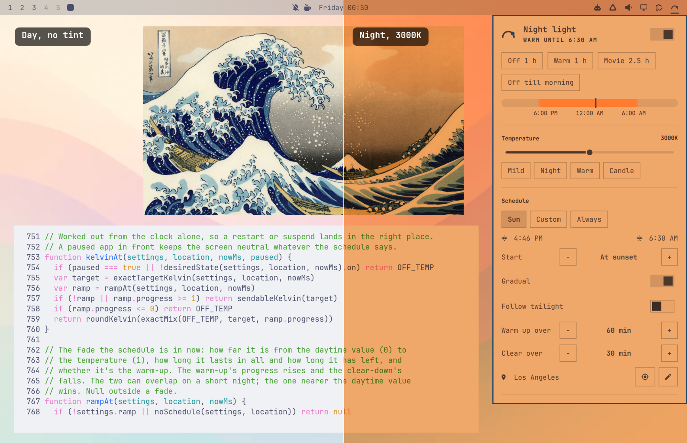
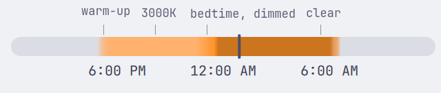
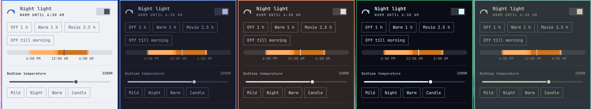
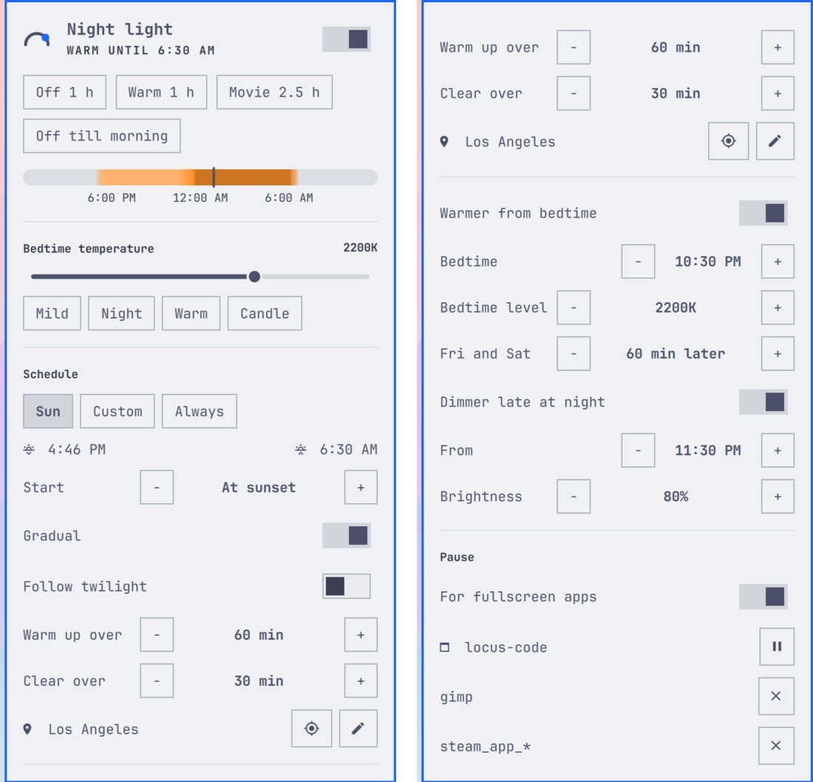
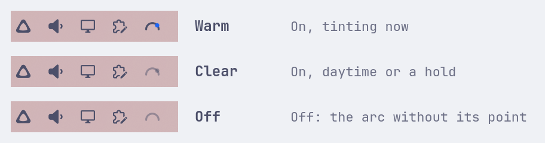

<h1 align="center">
  <picture>
    <source media="(prefers-color-scheme: dark)" srcset="branding/arc/lockup-dark.svg">
    
  </picture>
</h1>

**A night light for [Omarchy](https://omarchy.org) that follows the sun:**
gradual fades, timed holds, presets, a warmer bedtime, and pausing for apps
that need true colour.



<sub>Screenshots can't capture a screen's colour filter, so the warm half applies hyprsunset's own 3000K colour matrix to the same screenshot (`media/tint.sh`).</sub>

Locus warms your screen at sunset, or at hours you pick, and clears it by
sunrise, gradually enough that you're unlikely to notice it happening. It
lives in Omarchy's own shell, drives the `hyprsunset` Omarchy already ships,
and looks like the rest of your bar. (A locus is the path a point traces: the
logo is a warm point on the sun's arc, and the colours a night light moves
through lie on a curve called the Planckian locus.)


## What you get

- **Follows the sun, or your hours.** Sun mode is on from sunset to sunrise,
  worked out on your computer for where you are, and can start up to 3 hours
  before sunset or 2 after. Or pick your own hours, or keep it on all the
  time.
- **Gradual.** The screen warms over an hour after sunset and clears over the
  half hour before sunrise. Choose each length from instant to 3 hours, or
  let them follow twilight, so they stretch in summer and shrink in winter.
- **On, off, or off for a while.** The switch turns Locus on or off, like the
  switches in Omarchy's other panels. One click holds things for a while:
  **Off 1 h**, **Warm 1 h**, **Movie 2.5 h** (milder, 5000K) and **Off till
  morning**. The line under the title says when the screen will next change.
- **Your choice of warmth, down to deep red.** A slider from 5500K to 500K and
  four presets: Mild 4500K, Night 3400K, Warm 2700K, Candle 1900K. Below
  hyprsunset's 1000K floor, a screen shader takes away green and blue until
  only red is left.
- **A warmer bedtime, and dimmer late at night,** both optional. From 22:30 the
  screen moves to a second, warmer level (2200K), an hour later on Friday and
  Saturday nights. From 23:30 it can also dim past what your screen's own
  brightness reaches.
- **Steps aside for apps that need true colour:** any app in real fullscreen,
  apps you name (`steam_app_*` covers every Steam game), and a button to add
  the app in front.
- **The night at a glance.** The panel shows the day from noon to noon: when
  the screen warms and clears, bedtime and dimming, any hold, and now.

  

- **Looks like Omarchy.** The panel follows your theme, and the bar icon is
  Locus's mark: its point lights up in your theme's accent colour while the
  screen is warm, and disappears when Locus is off.

  

- **Light on your battery.** Locus looks at hyprsunset only when something is
  due, and otherwise once a minute: about 1,500 short checks a day, each one
  `hyprctl` call of about 9 ms of processor time. Pausing for apps listens to
  Hyprland's events instead of checking. Nothing runs for the panel while it's
  closed.
- **Plays well with Omarchy.** Omarchy's own Night Light toggle still works:
  Locus treats it as a hold until its next scheduled change. Locus never
  edits `hyprsunset.conf` or any of Omarchy's files.
- **A command at sunset and sunrise,** if you want one: a dark theme for the
  night, say.
- **Everything from the command line too,** through `omarchy-shell`.

## Install

```bash
omarchy plugin add https://github.com/cwilliams5/omarchy-locus.git --enable
omarchy restart shell
```

The icon appears at the right end of the bar. Left-click it for the panel.

Then, optionally:

- **One night light icon instead of two:** Omarchy's own Night Light stays in
  its indicators widget. To leave only Locus's, take `NightLight` out of that
  widget's `items` in `~/.config/omarchy/shell.json`.
- **Locus among Omarchy's indicators** instead of on its own: see
  [Show it with Omarchy's indicators](#show-it-with-omarchys-indicators).

**Dependencies:** none beyond Omarchy. It uses `hyprsunset`, Omarchy's
Quickshell shell, `jq` and `curl`, which Omarchy ships. Only for development:
`node`, for the tests.

**What it changes:** it writes only its own two settings files,
`~/.local/state/omarchy/settings/locus.json` and `locus-state.json` (readable
only by you), and, while the deep-red shader is on, a shader file in
`$XDG_RUNTIME_DIR/locus` that Hyprland's `screen_shader` setting points to
until Locus takes it off. It starts `hyprsunset` when the screen needs a tint.
It never edits `hyprsunset.conf`, your Hyprland config or anything else of
Omarchy's. It makes no network requests unless you turn on location detection
or look up a city.

## Uninstall

```bash
omarchy plugin remove io.github.cwilliams5.locus
hyprctl hyprsunset identity && hyprctl hyprsunset gamma 100
rm ~/.local/state/omarchy/settings/locus.json ~/.local/state/omarchy/settings/locus-state.json
```

The second line clears any tint or dimming left on the screen, and the third
deletes your settings. If you took `NightLight` out of the indicators, put it back in
`~/.config/omarchy/shell.json`.

**Tested with** Omarchy 4.5.0, Hyprland 0.56.2, hyprsunset 0.4.0 and
Quickshell 0.3.2, on an Intel laptop with a 2x screen. Sundown, which Locus
builds on, was tested on a MacBook Air (M1, 2020) running Asahi, where the
tint survived a suspend and resume.

## Known limits

- **One temperature for every screen:** hyprsunset applies the same setting to
  all monitors.
- **hyprsunset changes colour in whole steps of 100K** (0.4.0, and its code
  today), so an hour's fade from 6500K to 3000K changes the screen 35 times,
  in steps that grow from about 2 mireds at the start to about 11 near 3000K.
  Locus works fades out in finer steps and sends them; they'll show if
  hyprsunset ever applies them. The rounding was reported in
  [hyprwm/hyprsunset#94](https://github.com/hyprwm/hyprsunset/issues/94); its
  fix still rounds, reported in
  [hyprwm/hyprsunset#103](https://github.com/hyprwm/hyprsunset/issues/103).
- **Screenshots and screen recordings don't show the tint,** because it's
  applied on the way to the screen, after capture. Only the deep-red shader
  below 1000K shows up in them.
- **After a suspend,** the tint may not come back on some hardware:
  [omacom/omarchy#16052](https://github.com/omacom/omarchy/issues/16052)
  reports it disappearing on an AMD Framework laptop, while hyprsunset still
  reports the old value, so Locus can't tell. Turning Locus off and on sends
  the tint afresh.
- **Omarchy's stock `hyprsunset.conf` clears the tint at 07:00.** Locus reads
  that file, looks just after each of its switch times, and puts the tint
  back within seconds (a minute if hyprsunset switches late, as it can after
  a sleep). To avoid the blink, remove the profile from the file.
- **The time zone is only a rough location:** sunset can be off by a while if
  you live far from your time zone's main city. Type your city into the panel
  instead.

---

The rest of this page is the reference: how to use each part, every setting
and command, and notes for changing Locus.

## Using it

| Do this | And |
|---|---|
| Left-click the icon | Open the panel |
| Right-click the icon | Turn Locus on or off |
| Scroll on the icon | Change the temperature |

In the panel, Left and Right change the temperature, Enter turns Locus on or
off, and `m` changes the mode.



### On, off and holds

The switch at the top of the panel turns Locus on or off. On, it follows the
mode. Off, it leaves the screen alone until you turn it on again, through
restarts too, and the icon shows the arc without its point. The line under the
title says what happens next: "Warm until 6:30 AM", "Warms at 4:47 PM",
"Warm", or "Off".



For a while rather than for good, use the buttons under it: **Off 1 h** and
**Warm 1 h**, then back to the schedule; **Movie 2.5 h**, milder (5000K) for
long enough to watch a film; **Off till morning** for the rest of the night
(or for tonight, if it's still day); and **Back to schedule** ends any hold.
Turning Locus on or off ends a hold too. **Warm 1 h** and **Movie 2.5 h** also
work while Locus is off, which it is again when they end. Changing the
temperature during Movie mode changes it for the rest of the film only; your
saved temperature stays as it was.

### Modes

- **Sun:** on from sunset to sunrise. **Start** moves the beginning up to 3
  hours before sunset or 2 hours after it, in 15-minute steps.
- **Custom:** on between two times you choose.
- **Always:** warm whenever Locus is on.

### Fades

With **Gradual** on, which is the default, Sun and Custom modes warm the
screen over the hour after they turn on, and clear it over the 30 minutes
before they turn off. **Warm up over** and **Clear over** change those
lengths, from at once to 3 hours. Turn Gradual off to change at the scheduled
time instead. Turning Locus on or off always takes about 2 seconds.

In Sun mode, **Follow twilight** times the fades by the sky instead: the
screen warms from the start until civil dusk (when the sun is 6 degrees below
the horizon) and clears from civil dawn until sunrise, so the fades are longer
in summer and in the far north. With **Start** before sunset, the warm-up
starts that much earlier. Where the sun never gets that low, as on summer
nights in the far north, the lengths you set apply.

Locus works a fade out in steps of about 3 mireds and sends one when it has
moved far enough to matter. (hyprsunset itself changes colour only in whole
hundreds of Kelvin: see [Known limits](#known-limits).) It looks at hyprsunset
when something is due (a scheduled change, the next step, a switch time in
`hyprsunset.conf`) and otherwise once a minute, so a change made elsewhere is
noticed within a minute. It always looks before it sends anything, so it never
overwrites a change it hasn't seen yet.

### Temperature and presets

The slider runs from 5500K (mild) on the left to 500K (deep red) on the right.
Under it, **Mild**, **Night**, **Warm** and **Candle** set 4500K, 3400K, 2700K
and 1900K in one click. Moving the slider while the night light is off
previews that temperature for 10 seconds.

hyprsunset stops at 1000K, and on some screens that is more orange than red.
Below 1000K, Locus leaves hyprsunset there and adds a Hyprland screen shader
that takes away more green and blue, until 500K shows only red. A screen
shader you already use, like a grayscale one, keeps working underneath. The
shader goes away on a config reload and comes back within a minute.

### Bedtime and dimming

**Warmer from bedtime** adds a second, warmer level later in the night, in Sun
and Custom modes. From **Bedtime** (22:30 unless you change it), the screen
moves to the **Bedtime level** (2200K) over the warm-up length, or at once
with Gradual off. Nights that start on a Friday or Saturday reach bedtime
later (**Fri and Sat**, an hour unless you change it). A bedtime after
midnight counts for the night before it, and one that has already passed when
the night starts covers the whole night. Once bedtime has come, the slider,
the presets and scrolling on the icon change the bedtime level.

**Dimmer late at night** turns brightness down past what the screen's own
controls reach, through hyprsunset's gamma, in Sun and Custom modes. From
**From** (23:30 unless you change it) it eases down to **Brightness** (80%)
over 15 minutes, or at once with Gradual off, and comes back up with the
morning's clear-down. It stays at full brightness while an app has the night
light paused, during a hold that turns it off, and in Movie mode.

Both are off until you turn them on.

### The 24-hour strip

Under the hold buttons, a strip shows the day from noon to noon: when the
screen warms and clears, how strong the tint is, bedtime and dimming, any
hold, and a mark for now. It's worked out when the panel opens or a setting
changes; while the panel is open only the mark moves, once a minute.

### Omarchy's Night Light

`omarchy toggle nightlight` still works. It uses Omarchy's fixed 4000K, and
Locus leaves that alone until its next scheduled change, even during a
gradual change.

## Pausing for apps

Some apps need true colour, like games and photo or video editors. Locus can
keep the screen neutral while one of them is in front, and warm it again when
you leave it. The **Pause** section of the panel has:

- **For fullscreen apps:** any app in real fullscreen (Super+F). A maximized
  window doesn't count.
- **The app in front**, with a button to pause whenever it's in front, or to
  stop. The apps you've added are listed under it, each with a button to take
  it off.

A name ending in `*` matches every app whose class starts with the rest, so
`steam_app_*` covers every game started from Steam. Add one like that with
the `pauseapp` command below.

While an app has it paused, the switch stays on, and the status line and the
icon's tooltip name the app. Locus hears about focus and fullscreen changes
from Hyprland, so pausing adds no checking of its own.

## Run a command at sunset and sunrise

Locus can run a command of yours as the schedule turns on and off, for example
to switch to a dark theme for the night:

```bash
omarchy-shell io.github.cwilliams5.locus.control oncommand "omarchy theme set tokyo-night"
omarchy-shell io.github.cwilliams5.locus.control offcommand "omarchy theme set catppuccin-latte"
omarchy-shell io.github.cwilliams5.locus.control runcommand on    # Try it now
```

They run in the background with `sh -c`, only when the schedule itself
changes (Sun or Custom mode), including when you change the schedule so it
says the other, but not for holds, pausing, or turning Locus on or off. While
Locus is off, nothing runs. If the computer was asleep at sunset, the command
runs when it wakes; if it slept through the whole night, nothing runs.
Restarting the shell doesn't run either. Set one to `""` to stop it.

## Location

Sun mode uses the first of these it finds:

1. A city or coordinates you enter with the pencil button in the panel
2. Your detected location, if the crosshairs button is on
3. Omarchy's weather location, if it has coordinates and not only a name
4. The main city of your system time zone, from `/usr/share/zoneinfo/zone1970.tab`

A city is looked up once, when you press Enter, with
[Open-Meteo](https://open-meteo.com)'s geocoding service, which receives the
name you typed and nothing else. The first place it finds is kept with its
coordinates, so it isn't asked again; if it picks the wrong one, enter
coordinates instead (like `52.52, 13.40`). Place names come from
[GeoNames](https://www.geonames.org) (CC BY 4.0).

If none of these is available, Sun mode is warm whenever Locus is on, as in
Always mode, until you enter a location.

Location detection is off by default. It asks `geo.omarchy.org` for the city
of your IP address, as Omarchy's weather widget does, when the shell starts,
every few hours, and after a long sleep. The last answer is kept so it works
offline, and is deleted when you turn this off. A VPN will make it report the
VPN's location.

## Commands

```bash
ID=io.github.cwilliams5.locus.control

omarchy-shell $ID status                # Everything, as JSON
omarchy-shell $ID on                    # Locus on: follow the mode
omarchy-shell $ID off                   # Locus off until you turn it on
omarchy-shell $ID toggle
omarchy-shell $ID set 3000              # Save a temperature, from 500 to 5500
omarchy-shell $ID preset candle         # Or mild, night, warm
omarchy-shell $ID preview 2000          # Show a temperature for 10 seconds
omarchy-shell $ID schedule sun          # Or custom, or always
omarchy-shell $ID hours 21:00 07:00     # Custom on and off times
omarchy-shell $ID location "52.52, 13.40"
omarchy-shell $ID location Berlin       # Looked up once; status shows what it found
omarchy-shell $ID location ""           # Back to the automatic location
omarchy-shell $ID autolocation on       # Or off: detect location from your IP
omarchy-shell $ID offset 30             # Sun mode starts 30 min before sunset; negative is after
omarchy-shell $ID ramp off              # Or on: change gradually
omarchy-shell $ID fade 60 30            # Warm-up and clear-down in minutes, 0 to 180
omarchy-shell $ID twilight on           # Or off: Sun mode's fades follow dusk and dawn
omarchy-shell $ID hold off 60           # Off for 60 minutes; or hold on 60: warm for 60
omarchy-shell $ID movie                 # 5000K for 2.5 hours; or hold movie 100 for 100 minutes
omarchy-shell $ID morning               # Off for the rest of the night
omarchy-shell $ID resume                # End any hold
omarchy-shell $ID bedtime on            # Or off, or a time: bedtime 22:30
omarchy-shell $ID bedtimetemp 2200      # The bedtime level
omarchy-shell $ID weekend 60            # Bedtime this much later on Friday and Saturday nights
omarchy-shell $ID dim on                # Or off, or the time it starts: dim 23:30
omarchy-shell $ID dimlevel 80           # Brightness at its dimmest, 50 to 100 percent
omarchy-shell $ID pausefullscreen on    # Or off
omarchy-shell $ID pauseapp gimp on      # Or off; steam_app_* matches every Steam game
omarchy-shell $ID pausefront            # Pause for the app in front, or stop
omarchy-shell $ID oncommand "..."       # Run as the schedule turns on; "" for none
omarchy-shell $ID offcommand "..."      # Run as it turns off
omarchy-shell $ID runcommand on         # Run one now, to try it
```

## Settings

Your choices are saved in `~/.local/state/omarchy/settings/locus.json`, which
is safe to back up or keep in your dotfiles. The panel and the commands above
change it; if you edit it by hand, replace it whole (save to another name and
rename it over), because Locus may read a half-written file as empty.

| Setting | Default | What |
|---|---|---|
| `mode` | `"sun"` | `sun`, `custom` or `always` |
| `temperature` | `3000` | The night's temperature, 500 to 5500 Kelvin |
| `onTime`, `offTime` | `"21:00"`, `"07:00"` | Custom mode's hours |
| `sunsetOffset` | `0` | Minutes before sunset Sun mode starts (negative: after), -120 to 180 |
| `ramp` | `true` | Gradual: fade rather than switch |
| `fadeIn`, `fadeOut` | `60`, `30` | Warm-up and clear-down lengths in minutes, 0 to 180 |
| `twilight` | `false` | Sun mode's fades follow civil dusk and dawn instead |
| `bedtime` | `false` | A second, warmer level later in the night |
| `bedtimeAt` | `"22:30"` | When bedtime starts |
| `bedtimeTemperature` | `2200` | The bedtime level |
| `weekendDelay` | `60` | Minutes later on Friday and Saturday nights, 0 to 180 |
| `dim` | `false` | Dimmer late at night |
| `dimFrom` | `"23:30"` | When dimming starts |
| `dimPercent` | `80` | Brightness at its dimmest, 50 to 100 |
| `pauseFullscreen` | `false` | Neutral while an app is in real fullscreen |
| `pauseApps` | `[]` | App classes to pause for (up to 32; a trailing `*` matches a prefix) |
| `autoLocation` | `false` | Detect location from your IP address |
| `onCommand`, `offCommand` | `""` | Commands to run as the schedule turns on and off |

Things that change by themselves, or are private, go in `locus-state.json`
beside it instead, so syncing your settings never syncs your location: whether
Locus is on (`enabled`), any hold (`override`), the city or coordinates you
entered, and the detected location. Locus keeps both files readable only by
your account. If you used Sundown, Locus copies its settings
(`heliotrope.json`) once, the first time it runs, and sorts them into the two
files.

## Show it with Omarchy's indicators

To have the icon appear among Omarchy's indicators instead of on its own:

1. Set `showIcon` to `false` on the Locus entry in `~/.config/omarchy/shell.json`.
2. Add this to the `omarchy.indicators` `items`, using your own home folder:

```
../../../../../../../home/YOU/.config/omarchy/plugins/io.github.cwilliams5.locus/Indicator
```

The path is relative to Omarchy's indicators folder, because Omarchy has no
supported way to load another plugin's indicator yet.

## Developing

```bash
TZ=America/New_York node tests/model.test.js
```

The tests cover the schedule, fades, holds, bedtime, dimming, twilight, the
status line and the settings files, including day-long simulations that count
checks and measure every step. They also pass in other time zones such as
`America/Los_Angeles` and `UTC`. `omarchy plugin validate .` checks the
manifest. [CLAUDE.md](CLAUDE.md) explains how Locus works and the rules it
keeps, and `docs/PLAN.md` its development history.

The warm screenshots are made with `media/tint.sh`, which applies hyprsunset's
own colour matrix to a screenshot.

## Credits

Locus is a hard fork of [Sundown](https://github.com/WilliamJohnDavisIII/omarchy-sundown) by [William John Davis III](https://github.com/WilliamJohnDavisIII) (MIT). Its foundation is his work: the sun times and location, the way it drives `hyprsunset` and notices changes made elsewhere, the panel, and the extra-warm shader. His commits are kept in this repository's history.

Ideas, not code, from:

- [Dusk](https://github.com/ReidenXerx/omarchy-dusk) by ReidenXerx (MIT): starting before sunset; a fade length you choose; stepping aside for fullscreen apps and apps you name, with a button for the app in front; spacing fade steps by what the eye can tell apart (a few mireds) and looking about once a minute; reading `hyprsunset.conf`'s own switch times so they aren't taken for you; "off until morning" and "warm for an hour"; dimming late at night, below the screen's own minimum, eased in.
- [f.lux](https://justgetflux.com): the night light the rest descend from, including disabling for fullscreen apps, for the app in front, and for an hour; Movie mode; named colour presets like Candle; a warmer bedtime, and sleeping in at weekends; switching to dark mode at sunset.
- [Sunset Night Light](https://github.com/agkrishnendu/omarchy-nightlight) by agkrishnendu: a second, warmer temperature later in the evening.
- [Redshift](https://github.com/jonls/redshift) and [gammastep](https://gitlab.com/chinstrap/gammastep): changing with the sun's height through twilight rather than by the clock; running your own commands as night starts and ends.
- [Moonshine](https://github.com/tiagoabiramia/omarchy-moonshine) by Tiago Abi-Ramia: software dimming for Omarchy.
- [Night Light](https://github.com/key-tone/omarchy-nightlight) by Kenny Keeton: pausing for an hour, or until sunrise; one-click presets, including Night at 3400K and Candle at 1900K; looking up a city with Open-Meteo.

The screenshots show *The Great Wave off Kanagawa* by Katsushika Hokusai (public domain), as shipped with Omarchy's Kanagawa theme.

## License

MIT. See [LICENSE](LICENSE).
